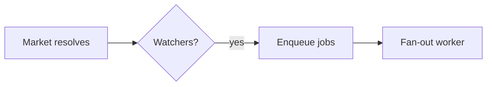

# Plan Canvas

プランとビジュアルなアーティファクトのためのレビューループです。あなたがアーティファクトを書き、人間がブラウザでレビューします。人間は対象の要素に直接注釈を付け、チャットし、**Approve plan / Request changes** の判定を返します。その間、あなたはフィードバックを JSON として返す単一の CLI 呼び出しでブロックして待機します。

[lavish-axi](https://github.com/kunchenguid/lavish-axi) に着想を得て、`/plan` の確認ゲートを中心に ECC ネイティブで再構築し、依存関係をゼロにしています。

## 使用するタイミング

- プランのアーティファクト（`/plan` が出力する `.claude/plans/*.plan.md`）を書き終え、CONFIRM／承認の判断が必要なとき。キャンバス上の判定が、入力による「yes/proceed」の代わりになります。
- ユーザーが変更箇所を文章で説明するのではなく*指し示す*べきとき。デザイン、比較、レポート、その他ローカルの `.md` / `.html` アーティファクトのレビューが該当します。
- ユーザーが `/plan-canvas`、ビジュアルレビュー、または「ブラウザで開いて」と求めたとき。

次の用途には使用しないでください: diff のコードレビュー（`/code-review`）、Web アプリの実行、リモート URL。キャンバスが配信するのはローカルのアーティファクトファイルのみです。

## 仕組み

CLI は `ecc-plan-canvas` として起動します。これは `ecc-universal` パッケージが提供する bin です（グローバルインストールまたはプラグインインストール後は PATH 上にあります。プラグインインストールでは `node "$CLAUDE_PLUGIN_ROOT/scripts/plan-canvas.js"` でも動作します）。レビュー対象のプロジェクト内から実行してください。ただし、どの作業ディレクトリからでも動作します。CLI は、すべてのセッションで共有され、アーティファクトのパスをキーとするデタッチされたループバックサーバー（`127.0.0.1:4517`）を管理するため、セッション ID を追跡する必要はありません。

このワークフローは単純な CLI と JSON のループなので、モデルやハーネスに依存しません。シェルコマンドを実行して stdout を読めるエージェントであれば、どれでも同じように操作できます（Claude Code、Codex、Cursor、Gemini、OpenCode、Copilot）。ハーネスがスキルを呼び出す方法で起動してください。たとえば Claude Code では `/plan-canvas`、Codex では `$plan-canvas` です。あるいは `ecc-plan-canvas` コマンドを直接実行しても構いません。

```bash
# 1. ユーザーのブラウザでアーティファクトを開く（即座に戻る）
ecc-plan-canvas open .claude/plans/feature.plan.md

# 2. 人間が応答するまでブロックする。実行したままにし、中断された場合は再実行する:
#    キューに入ったフィードバックは失われない。
ecc-plan-canvas await .claude/plans/feature.plan.md
```

### 待ち受けを続ける:さもないと人間は空の椅子に話しかけることになる

フィードバックがあなたに届くのは、`await` が実際にセッション上で待機している間だけです。待ち受けが何もない状態でターンが終わると、メッセージはキューに留まり、人間の側から見ると送信しても何も起きていないように見えます。

そのため、ハーネスが対応している場合は、**`await` をバックグラウンドタスクとして実行**してください（Claude Code では `run_in_background: true` を指定した Bash 呼び出し）。フィードバックが届いた瞬間に終了し、ハーネスがその JSON をあなたに渡すので、フォアグラウンドの呼び出しとともにループが終わることなく、ターンをまたいでループが維持されます。フォアグラウンドの `await` でも動作しますが、ハーネスによる時間制限までに限られます。

安全策が 2 つありますが、どちらも上記を省略してよい理由にはなりません。

- `ecc-plan-canvas pending` は、リスナーがいない状態でキューに入っているフィードバックを一覧表示します。見逃した可能性があるか確信が持てないときは、いつでも確認してください。
- `stop:plan-canvas-pending` フックは、キャンバスのフィードバックが未配信の間はあなたのターンが終了するのをブロックし、そのメッセージを渡します。このフックからフィードバックを読んでいるなら、待ち受けを早く止めすぎたということです。

人間が操作すると、`await` は JSON を出力します。

```json
{
  "status": "feedback",
  "items": [
    { "kind": "annotation", "text": "Split this into two phases",
      "anchor": { "selector": "h2:nth-of-type(3)", "tag": "h2", "snippet": "Phase 2: Migration" } },
    { "kind": "verdict", "verdict": "request-changes" }
  ]
}
```

- `kind: "chat"` — 自由形式のメッセージです。ターミナルではなくキャンバス上で回答してください。
- `kind: "annotation"` — 要素に紐づいたフィードバックです（`anchor.selector` と `anchor.snippet` が、人間が指し示した対象を示します。人間が文章の一節をハイライトした場合は `anchor.textRange.text` も含まれます）。
- `kind: "verdict"` — `approve` はプランが CONFIRMED になったことを意味します。ポーリングを止め、セッションを終了し、実装を開始してください。`request-changes` は、アーティファクトを修正し（キャンバスはライブリロードされます）、ループを継続することを意味します。

**3. 常にキャンバス上で応答し**、そのうえで待ち受けを続けます。1 つのコマンドで両方を行えます。

```bash
ecc-plan-canvas await <file> --reply "Split Phase 2 as requested. Take a look."
```

人間からのメッセージにはすべて、キャンバスで返信してください。「On it, rewriting the risk table now.」のような一言でも構いません。チャットパネルが無言のままだと、キャンバスが壊れているのと区別がつきません。このループが防ごうとしているのは、まさにその失敗です。ターミナルだけでなく、必ずキャンバス上で回答してください。

作業中は、アクティビティインジケーターでチャットの状況を正直に保ってください。

```bash
# アニメーションする「agent is thinking...」バブル。長い作業中は更新し続ける
ecc-plan-canvas typing <file> --state thinking
# 返信が届く直前に「agent is typing...」に切り替える
ecc-plan-canvas typing <file> --state typing
```

`await` は、メッセージのバッチを渡した瞬間に `thinking` を自動で設定し、`--reply` がそれを解除します。どちらの状態も自動的に失効するため、エージェントがクラッシュしても、人間がいつまでもドットを眺め続けることはなく、正直な「queued」表示に戻ります。修正に 1 分以上かかる場合は `thinking` を更新してください。

**4. 終了**: レビューが完了したら `ecc-plan-canvas end <file>` を実行します。

## ダイアグラム（Mermaid）

プランの一部がフロー、アーキテクチャ、シーケンス、ステートマシン、ER モデル、依存関係グラフである場合は、ASCII アートや長い文章の代わりに、フェンス付きの ` ```mermaid ` ブロックとして記述してください。キャンバスはそれをテーマ適用済みのダイアグラムとして描画し、人間はそれを指し示せます。段落より図の方が速く読めるときに使い、単純なリストや表では使わないでください。

````markdown

````

ダイアグラムは、アクセントパレットを使った ECC のダークテーマで描画されます。Mermaid はブラウザで固定バージョンの CDN から読み込まれます。利用できない場合（オフライン時）は、ブロックがソース表示にフォールバックするため、レビューが妨げられることはありません。エアギャップ環境では、`ECC_PLAN_CANVAS_MERMAID_URL` にローカルミラーを指定してください。

## ルール

- Markdown のアーティファクトは ECC のプランテンプレートで描画されます（Mermaid ブロックを含みます）。`.html` のアーティファクトは、注釈レイヤーが注入された状態でそのまま描画されます。HTML 作成のガイダンスには、`frontend-design-direction` と `artifact-design` のスキルを使用してください。
- 修正するにはアーティファクトファイルを編集してください。キャンバスは保存時にライブリロードされます。更新のために `open` を再実行しないでください。
- `{"status": "ended", "endedBy": "user"}`（またはフィードバックバッチ上の `sessionEnded: true`）は、ユーザーがレビューを閉じたことを意味します。ポーリングを止め、残りの更新はチャットで伝え、再度開かないでください。そのセッションに対する単純な `open` は拒否されます。`--reopen` を渡すのは、ユーザーが再開を求めたときだけにしてください。
- 画像や CSS などの付随アセットは、アーティファクトと同じディレクトリに置き、相対パスで参照する必要があります。
- サーバーはループバック専用で、アイドル状態が 30 分続くと終了します（`ECC_PLAN_CANVAS_IDLE_MS`）。明示的に停止するには `stop` を使います。状態は `~/.claude/plan-canvas/` に保存されます（`ECC_PLAN_CANVAS_STATE_DIR`）。

## 例

**プラン承認フロー** — `/plan` が `.claude/plans/notifications.plan.md` を書き出し、確認を待たなければならない場合:

```bash
ecc-plan-canvas open .claude/plans/notifications.plan.md
ecc-plan-canvas await .claude/plans/notifications.plan.md
# → {"status":"feedback","items":[{"kind":"verdict","verdict":"approve"}]}
ecc-plan-canvas end .claude/plans/notifications.plan.md
# プランは確認済み — 実装を開始する
```

**修正ループ** — フィードバックが届き、ファイルを編集し、返信して、待ち受けを続けます:

```bash
# await が注釈を返した → .plan.md を編集する（キャンバスはライブリロードされる）
ecc-plan-canvas await <file> --reply "Reworked the risk table."
# → 次の応答があるまで再びブロックする
```

## アンチパターン

- `--timeout-ms` を使ってループでポーリングすること。これはテスト用に存在します。代わりに、通常の `await` を実行したままにしてください。
- レビューがまだ開いているのに、`await` による待ち受けがない状態でターンを終えること。これは、人間が「メッセージを送ったのに何も起きなかった」と感じる唯一の失敗です。
- フィードバックを読んだのに、ターミナルでしか回答しないこと。人間が見ているのはキャンバスです。
- ユーザーが開始した終了のあとに、「ただ見せるため」に再度開くこと。
- プラン全体をチャットに貼り付け、*かつ*キャンバスも開くこと。キャンバスを選び、ターミナルの要約は 1 行にとどめてください。
- 状態ファイルからキャンバスのチャットを解析すること。必要なものはすべて `await` 経由で届きます。

設計メモと由来: [docs/design/plan-canvas.md](../../../design/plan-canvas.md)。
